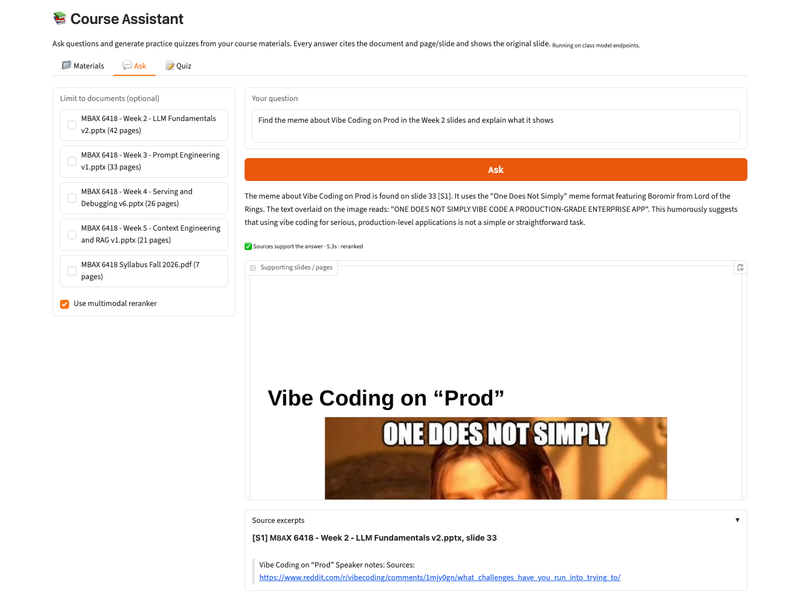
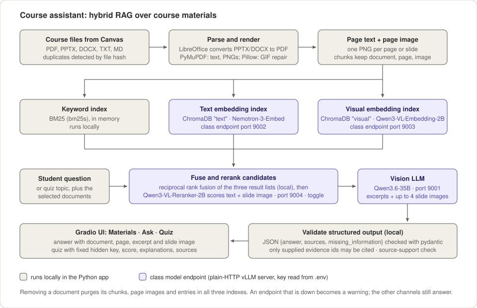
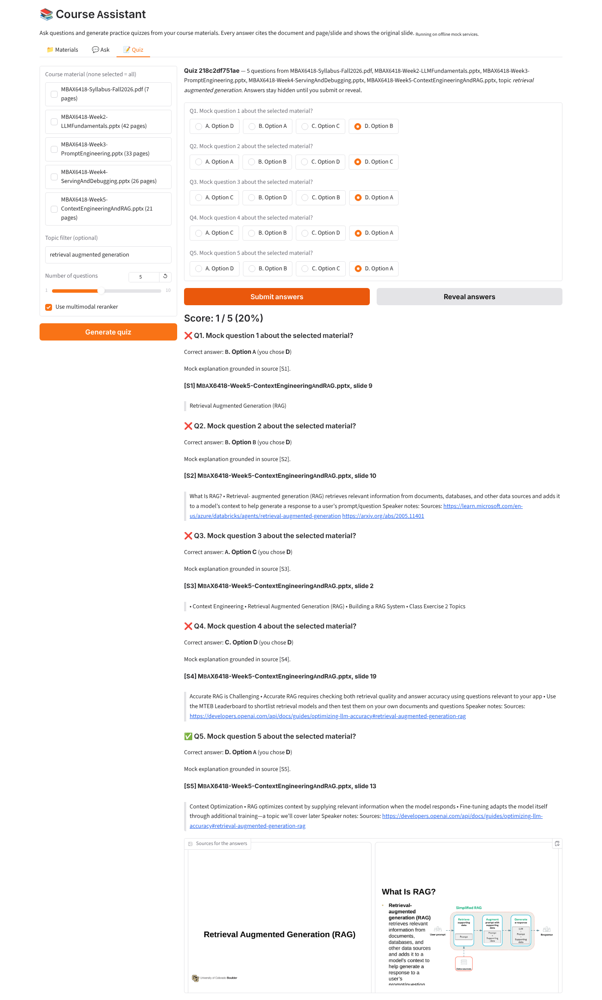

# Course Assistant (MBAX 6418, Assignment 2)

A Python app that answers questions and generates practice quizzes from course
materials downloaded from Canvas. It uses hybrid retrieval-augmented generation
(RAG): keyword search, text embeddings and visual embeddings over every page and
slide, fused and reranked, then a vision-capable LLM writes an answer that cites the
document and page or slide and shows the original slide image.



**Contents:**
[Features](#features) ·
[Architecture](#architecture) ·
[Setup](#setup) ·
[Usage](#usage) ·
[Supported formats](#supported-formats-and-conversion) ·
[Tests](#tests) ·
[Results](#results-reranker-on-vs-off) ·
[Limitations](#limitations-and-known-issues) ·
[Contributing](#contributing)

## Features

- **Manage materials:** add and remove PDF, PowerPoint, Word, text and Markdown
  files in the app. The same file added twice (even under another name) is detected
  by its content hash and not duplicated. Removing a file deletes its text, page
  images and entries in all three indexes, so later answers cannot use it.
- **Ask questions:** answers come only from the loaded materials, cite the document
  and page or slide, show the source excerpt and the slide image, and can describe
  pictures, diagrams and charts. When the materials do not contain the answer, the
  app says so and cites nothing.
- **Practice quizzes:** choose documents and an optional topic; get multiple-choice
  questions with a fixed answer key that stays hidden until you submit or reveal,
  a score, explanations, and the source slides for every question.
- **Graceful degradation:** if a model service is down, the app warns and answers
  with the remaining channels, or lists the most relevant passages, rather than
  failing.

## Architecture



| Component | What it does | Where it runs |
|-----------|--------------|---------------|
| Ingestion (`course_assistant/ingest.py`) | Converts PPTX and DOCX to PDF with LibreOffice, extracts text with PyMuPDF, renders one PNG per page or slide, and splits text into chunks that never cross a page boundary, so every chunk keeps its document, page number and image | Local |
| Library (`library.py`) | Stores uploaded files, detects duplicates by SHA-256, removes a document and its index entries | Local |
| Keyword index | BM25 (bm25s) over chunk text | Local, in memory |
| Text embedding index | ChromaDB collection `text`; chunks embedded with `nvidia/Nemotron-3-Embed-1B-BF16` | Class endpoint, port 9002 |
| Visual embedding index | ChromaDB collection `visual`, kept separate from text; each page image embedded with `Qwen/Qwen3-VL-Embedding-2B`, and questions embedded into the same space | Class endpoint, port 9003 |
| Fusion (`index.py`) | Reciprocal rank fusion of the three result lists | Local |
| Reranker | `Qwen/Qwen3-VL-Reranker-2B` scores each candidate's text and slide image against the question; can be switched off in the UI | Class endpoint, port 9004 |
| Answering (`qa.py`) and quizzes (`quiz.py`) | Sends the question, tagged text excerpts and up to four slide images to `cyankiwi/Qwen3.6-35B-A3B-AWQ-4bit`; requires JSON with separate `answer` and `sources` fields | Class endpoint, port 9001 |
| Validation | Checks the JSON with pydantic, drops citations of evidence that was never supplied, and checks that the cited sources actually support the answer | Local |
| UI (`ui.py`) | Gradio app with Materials, Ask and Quiz tabs | Local, in your browser |

The class endpoints are vLLM servers. Their verified request formats are in
[`docs/ENDPOINTS.md`](docs/ENDPOINTS.md). The document-parsing endpoint (port 9005)
is not used; local parsing covers every supported format.

## Setup

### Requirements

- Python 3.12 (3.11 should also work).
- **LibreOffice** for PowerPoint and Word files. Without it, PDF, TXT and MD still
  work, DOCX falls back to text only, and PPTX must be exported to PDF by hand.
  - macOS: `brew install --cask libreoffice`
  - Ubuntu/Debian: `sudo apt install libreoffice`
  - Windows: install from libreoffice.org
  - If `soffice` is not on your PATH, the app also looks in the standard install
    locations, or you can set `SOFFICE_PATH` to the executable.
- Access to the class model endpoints (URL and key from the instructor), or use
  mock mode to try the app offline.

### Install

```bash
git clone https://github.com/jones-benjam/MBAX_build_a_course_assistant.git
cd MBAX_build_a_course_assistant
python3 -m venv .venv
source .venv/bin/activate        # Windows: .venv\Scripts\activate
pip install -r requirements.txt
```

### Configure the endpoints

Copy the template and fill in the values from the class endpoint list:

```bash
cp .env.example .env
```

> **Important:** `.env.example` starts with `MOCK_SERVICES=1` (offline stand-ins).
> After filling in the URLs and keys, change it to `MOCK_SERVICES=0`, or the app
> will run on the stand-ins and its answers will not be meaningful.

`.env` is in `.gitignore` and must never be committed. The template contains only
dummy values, for example:

```dotenv
MOCK_SERVICES=0                       # 1 = offline stand-ins, 0 = real endpoints

LLM_BASE_URL=http://model-host.example.edu:9001
LLM_API_KEY=sk-dummy-llm-key
LLM_MODEL=cyankiwi/Qwen3.6-35B-A3B-AWQ-4bit

TEXT_EMBED_BASE_URL=http://model-host.example.edu:9002
TEXT_EMBED_API_KEY=sk-dummy-embed-key
TEXT_EMBED_MODEL=nvidia/Nemotron-3-Embed-1B-BF16

VISUAL_EMBED_BASE_URL=http://model-host.example.edu:9003
VISUAL_EMBED_API_KEY=sk-dummy-visual-key
VISUAL_EMBED_MODEL=Qwen/Qwen3-VL-Embedding-2B

RERANK_BASE_URL=http://model-host.example.edu:9004
RERANK_API_KEY=sk-dummy-rerank-key
RERANK_MODEL=Qwen/Qwen3-VL-Reranker-2B
```

Notes:

- Give each base URL as `http://host:port`; the app adds `/v1` if it is missing.
- Use port 9001 for the LLM. Port 9000 is reserved for the Hermes agent.
- The key is read only on the server side and sent only in the `Authorization`
  header. It never appears in the UI, logs, error messages or saved results.
- `MOCK_SERVICES=1` runs everything with deterministic offline stand-ins. It is
  useful for development and is what the test suite uses, but its answers are not
  meaningful.
- Other settings: `DATA_DIR` (default `data`), `CHUNK_SIZE`, `CHUNK_OVERLAP`,
  `TOP_K` (evidence items per answer, default 8), `USE_RERANKER` (default on),
  `RERANK_CANDIDATES` (most pages or slides sent to the reranker per question,
  default 10; each page is scored once, with its image sent once).

### Launch

```bash
python app.py                    # http://127.0.0.1:7860
python app.py --port 8080        # another port
```

`--share` creates a temporary public Gradio link. Use it with care: anyone with the
link can use the app and therefore your endpoint key's quota.

Uploaded files, page images and indexes are stored under `data/` (gitignored) and
persist between runs. Delete `data/uploads`, `data/pages`, `data/index` and
`data/library.json` to start with an empty library.

## Usage

**Materials tab.** Drop one or more files on "Add course files" and click
**Add to library**. The table lists each document with its page and chunk counts.
Adding a file that is already loaded reports it as a duplicate. To remove a
document, pick it under "Remove a document" and click **Remove selected**.

**Ask tab.** Type a question and click **Ask**. Optionally tick documents under
"Limit to documents" to search only those. The answer shows the cited sources as
`[S1]`, `[S2]` and so on, a support indicator, the supporting slide or page images,
and the source excerpts with document name and page or slide number. Try:

- "Find the meme about Vibe Coding on Prod in the Week 2 slides and explain what it shows"
- "How is the final grade calculated in this course?"
- "What does the chart on the Vibe Coding slide show?"

**Quiz tab.** Pick documents (none selected means all), an optional topic, and the
number of questions, then click **Generate quiz**. Answer the questions and click
**Submit answers** to see your score, the correct answers, explanations and source
slides, or click **Reveal answers** to see the key without scoring.



More screenshots, in light and dark mode, are in
[`docs/screenshots/`](docs/screenshots/).

## Supported formats and conversion

| Format | How it is processed | Extra software |
|--------|---------------------|----------------|
| PDF | Text per page; each page rendered as an image | none |
| PowerPoint (.pptx) | Converted to PDF with LibreOffice in headless mode, then handled like a PDF, so every slide keeps its text and its rendered image. Speaker notes are added to the slide's text | LibreOffice |
| Word (.docx) | Converted to PDF with LibreOffice, then handled like a PDF. Without LibreOffice, text only and no page images | LibreOffice (recommended) |
| Text (.txt, .md) | Split into page-sized sections; no images | none |

Older `.ppt` and `.doc` files are not accepted; save them as `.pptx` or `.docx`
first. **Manual workaround:** if LibreOffice is unavailable, export the deck to PDF
in PowerPoint or Keynote (File, then Export, then PDF) and upload the PDF.

We checked every converted slide of the Week 2 to 5 decks (122 slides) on a contact
sheet. Layout, text, tables, diagrams and still images render correctly, including
image-only slides such as the meme on Week 2 slide 33. Animated GIFs are handled
too: LibreOffice draws only their first frame (which on three slides — Week 2
slide 37, Week 4 slide 5, Week 5 slide 8 — is blank or black), so the assistant
pastes the GIF's most informative frame over that area after conversion, keeping
the page image and the visual index meaningful. Only areas that rendered blank are
patched, and the frame's transparency is kept, so GIF logos and icons that already
render correctly are left untouched.

## Tests

```bash
./run_tests.sh                                         # offline, mock services, no key
python -m pyflakes course_assistant tests scripts app.py
```

`pyflakes` (the linter) is included in `requirements.txt`. `run_tests.sh` is a bash
script; on Windows run the same suite from the activated virtual environment with:

```bat
set MOCK_SERVICES=1
python -m pytest -q
```

The offline suite has 99 tests: unit tests for parsing, chunking, indexing, fusion,
JSON validation, source support, quiz grading, animated-GIF handling, key redaction
in error messages and the HTTP request formats, and end-to-end tests through the app
for adding, duplicate uploads, removal, answering, missing information, quizzes, and
services being unavailable, plus the retrieval speed-ups, query caching and
control-token handling. Three LibreOffice-dependent tests (two PPTX and one DOCX)
are skipped if LibreOffice is not installed, so 96 run on a machine without it.

With a filled `.env`, ten more tests check the real services and the real course
files: each endpoint, duplicate upload, a syllabus answer, the meme found through
the visual path, an unanswerable question, a quiz, and removal. Put the course
files in `course_materials/` (gitignored) first:

```bash
LIVE_SERVICES=1 MOCK_SERVICES=0 python -m pytest tests/test_live_services.py -v -s
```

## Results: reranker ON vs OFF

We evaluated 10 questions on the syllabus and the Week 2 to 5 decks (129 pages and
slides), asking each question once with the reranker on and once with it off, on
the same index. Full results and every answer are in
[`data/results/eval_latest.md`](data/results/eval_latest.md); the analysis is in
[`docs/EVALUATION.md`](docs/EVALUATION.md). To reproduce:

```bash
MOCK_SERVICES=0 python scripts/evaluate.py --materials course_materials
```

### Question set

| Type | Question | Expected source |
|------|----------|-----------------|
| Syllabus | How is the final grade calculated in this course? | Syllabus p.2 |
| Syllabus | When are the professor's office hours and how are they held? | Syllabus p.1 |
| Syllabus | What is the late policy for assignments and quizzes? | Syllabus p.2 to 3 |
| Slide text | What is quantization, and roughly how large is Qwen3-Coder-30B-A3B-Instruct at 16, 8 and 4 bits? | Week 2 slide 15 |
| Slide text | What is ChatML and which special tokens does it use to mark messages? | Week 3 slide 8 |
| Slide text | According to the Week 4 slides, why would you create a branch in a repository, and what is the default branch usually called? | Week 4 slide 25 |
| Slide text | In a hybrid RAG pipeline, what does the reranking step do? | Week 5 slide 18 |
| Visual | Find the meme about Vibe Coding on Prod in the Week 2 slides and explain what its image and text show. | Week 2 slide 33 (title only; the content is in the image) |
| Visual | What does the chart on the "Vibe Coding" slide in Week 2 show, and what happened around 2025? | Week 2 slide 29 (a Google Trends chart, no body text) |
| Not answerable | What was the class average score on Assignment 1? | none |

An answer counts as correct when it contains every expected fact and does not
claim the information is missing. The unanswerable question is correct when the
app says the information is missing and cites nothing. We also read every answer.

### Comparison

| Metric | Reranker ON | Reranker OFF |
|--------|-------------|--------------|
| Correct answers | 8 / 10 | 9 / 10 |
| Answers whose sources support them | 10 / 10 | 10 / 10 |
| Expected page cited (9 answerable questions) | 9 / 9 | 9 / 9 |
| Expected page ranked first in retrieval | 9 / 9 | 5 / 9 |
| Mean rank of the expected page | 1.0 | 1.67 |
| Mean retrieval time | 3.9 s | 0.4 s |
| Mean time per answer, end to end | 5.1 s | 1.9 s |
| Median time per answer, end to end | 4.2 s | 1.7 s |
| Unanswerable question handled correctly | yes | yes |

### Interpretation

- **The reranker improves which evidence comes first.** With it, the expected slide
  was the top-ranked evidence for all nine answerable questions. Without it, the
  expected slide was still retrieved but ranked second or third for four
  questions, including both visual questions. The meme slide dropped to third.
- **Answer correctness was about the same.** The one difference was the late-policy
  question: with the reranker, the answer left out that the lowest score is
  dropped. Without it, a neighbouring chunk was included and the answer mentioned
  it. The expected page was ranked first in both runs, so this is a difference in
  the LLM's wording, not a retrieval failure.
- **The cost is about 3 seconds per question,** because each candidate's slide
  image is sent to the multimodal reranker.
- **Decision: we keep the reranker on by default** and leave the toggle in the UI.
  The cited (and therefore displayed) slide was correct for all nine answerable
  questions in both modes, so the reranker is not what makes the displayed slide
  right. What it adds is precision: the expected slide was always the top evidence,
  and answers carried fewer extra citations, so the first image shown is the right
  one. That matters most for visual questions, where the LLM cannot compensate with
  text. A few extra seconds is acceptable for a study tool, and users who want quick
  text lookups can switch it off. Reranker off is a reasonable default too: it was
  as accurate on this question set and about 2.5 times faster, so the choice is
  precision of the first slide shown against speed, not correctness.

### Failure investigated: special tokens disappear from answers

The ChatML question failed in both runs for the same reason. A correct answer must
name the tokens `<|im_start|>` and `<|im_end|>`, but the model's answer read
"uses `<|im_start|>` to mark the beginning of a message and `` to mark the end",
with the second token missing. We asked the LLM endpoint directly to repeat these
tokens and it returned empty strings in their place, with and without vLLM's
`skip_special_tokens: false` option. The tokens are the model's own control tokens
and the server strips them from generated text. Retrieval was correct and the slide
excerpt shown next to the answer contains both tokens, so the user still sees them.
The app now works around this: control tokens in the evidence and the question are
sent to the model in a spaced form (`< |im_end| >`), which the server does not
strip, and the answer is turned back into `<|im_end|>` before it is shown. This
has unit tests but has not yet been re-run against the live endpoint.

## Limitations and known issues

- **Control tokens in answers** depend on the model copying the spaced form
  described above. If it writes the raw token anyway, the server still strips it;
  the source excerpt always shows the original tokens.
- **Slide numbers vs. evidence numbers:** the LLM sometimes cites a slide number
  where it should cite an evidence tag such as `[S3]`. The app detects this and
  remaps the citation to the block from that slide when it supports the answer,
  with a warning. The model's explanation text can still mention a slightly wrong
  slide number even when the citation is right.
- **The source-support check is lexical.** It measures how many of the answer's
  content words appear in the cited excerpts. Answers about images use words that
  appear only in the picture, so for image-backed sources any overlap counts as
  supported. It catches unsupported answers but cannot prove an answer is correct.
- **Animated GIFs** on slides are rendered as their first frame by LibreOffice.
  The assistant now replaces a blank/black first frame with the GIF's most
  informative frame, so the page image shows what the animation contains. Only a
  single representative frame is used (the animation itself does not play in the
  still page image), and if frame extraction fails the rendered page is used
  unchanged. GIFs inside grouped shapes are not detected, picture cropping is
  ignored, and decks added before this fix keep their old page images until they
  are removed and added again.
- **Ingestion speed:** each page image is embedded with a separate request, so a
  42-slide deck takes about 40 seconds to add.
- **Slide numbers in generated prose.** Earlier prompts labelled evidence with
  "tag" numbers, and quiz explanations sometimes echoed them or named the wrong
  slide (the committed `docs/screenshots/quiz-light.png` predates the fix: its Q1
  says "Slide 5 (Tag 5)" while citing Week 5 slide 11). Evidence is now labelled by
  document and slide or page, and the prompts forbid calling the evidence blocks
  "tags" (the word itself stays allowed for course content about tags). In a
  check of 30 real quiz questions, explanations naming a slide outside their cited
  sources fell from 5 to 0, and none mentioned tags. The model still sometimes
  writes markers like "[S2]" in explanations; these match the source labels shown
  under each question. This differs by design: answers may carry inline "[S2]"
  markers, which match the numbered sources listed under the answer, while quiz
  prompts ask for none. The cited sources remain the authority, not the prose.
- **Quiz topic filter:** dense search always returns neighbours, so a topic that is
  not in the materials still produces a quiz from the closest content instead of
  an error.
- **PDF text from slides keeps hard line breaks** inside bullets. This does not
  affect search but makes some excerpts look ragged.
- **Single-user, local app** with no login. The Materials table squeezes its column
  headers in narrow windows.

### What was tested and what was not

Tested: every endpoint's request format against its documentation; the live
services with the real course files; adding, duplicate detection and removal;
text, syllabus and visual questions; missing information; quiz generation,
grading and hidden answers; unavailable services, simulated in the offline tests;
light and dark mode in the UI.

Not tested: variance across repeated runs (each evaluation question was run once
at temperature 0); other chunk sizes or `top_k` values (only the reranker was
compared); `.doc`, `.ppt` and scanned PDFs without a text layer; the Week 6 and
"Local Inference" decks; concurrent users; Windows and Linux setups.

## Contributing

See [`CONTRIBUTING.md`](CONTRIBUTING.md) for the team workflow (issue, branch, pull
request, review) and [`AGENTS.md`](AGENTS.md) for instructions that coding agents
such as Hermes or Claude Code read first. The build plan and its status are in
[`docs/PLAN.md`](docs/PLAN.md) and [`docs/HANDOFF.md`](docs/HANDOFF.md).

Keep API keys out of the repository: they belong only in your local `.env`. Some
course slides (Week 4, slides 12 and 13) print the class endpoint key, so never put
those slides in screenshots, saved results or issue comments.
